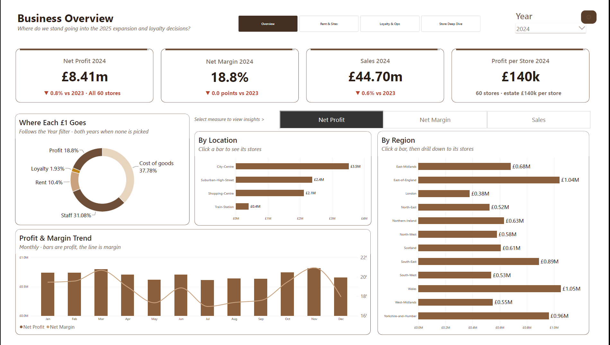
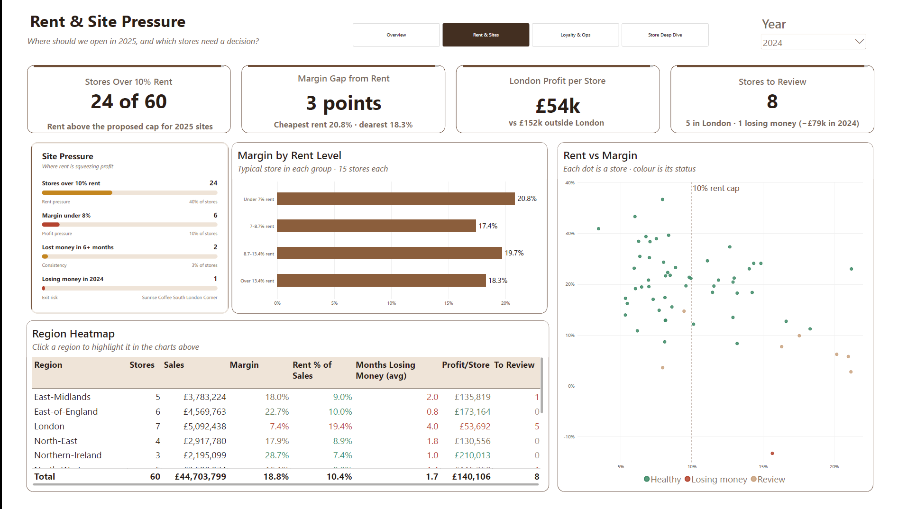
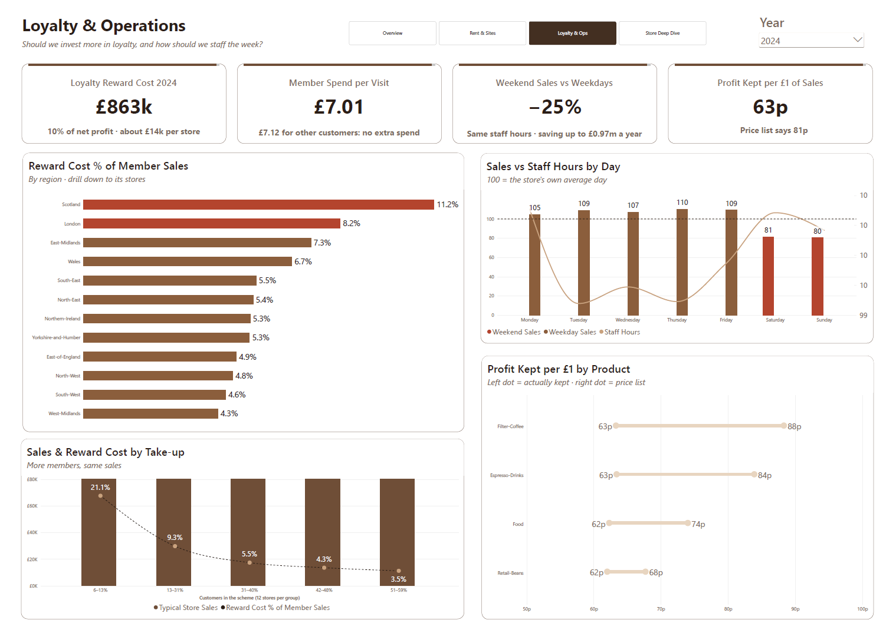
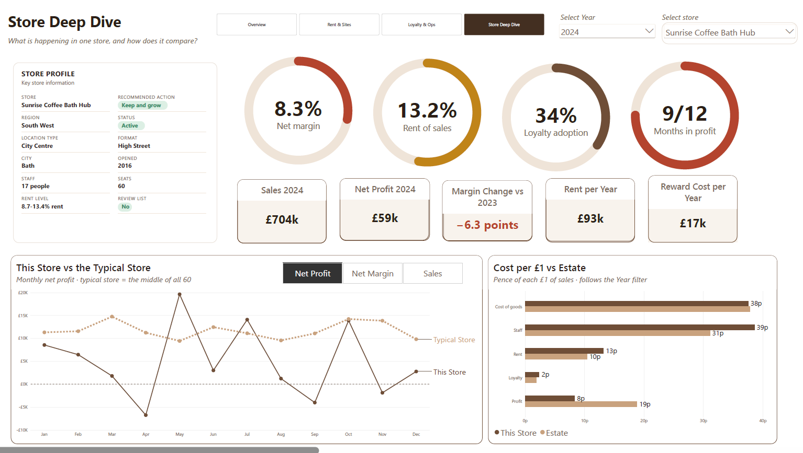

# Sunrise Coffee: store performance review (2023-2024)

**[View the live interactive report](https://app.powerbi.com/view?r=eyJrIjoiODBkNDIwYTUtYjg0Mi00MWMyLWJmZGMtNjc4MzQyZjFkZDRiIiwidCI6IjQ3NzFkZTJmLWRjNzYtNGE2Mi04OTkzLWFjNTllODJmODE4YSJ9)** · [Read it as a PDF](docs/SunriseCoffee-report.pdf) (no Power BI needed for either)

**Bottom line:** London is the one weak region. Its stores sell about as much as the typical store but pay roughly twice the rent share (about 20% of revenue against 9%), so they keep less than half the margin. The loyalty scheme costs **£0.86m a year** in rewards with no visible extra spend from members. Weekend sales run about a quarter below weekdays while staff hours stay flat, which is worth up to **£0.97m a year**.




A Power BI report on store profitability, loyalty ROI and labour for a 60-store UK coffee chain, built for the DataDNA Dataset Challenge (October 2026). The brief casts me as a senior commercial analyst reporting to the Chief Commercial Officer. Rather than build "a dashboard", the report is organised around the three decisions the CCO has to make before the 2025 planning cycle.

## The three decisions and what the data says

All figures come from [analysis/outputs/findings.md](analysis/outputs/findings.md), which `analysis/run_analysis.py` regenerates from the raw CSVs.

### 1. Which stores or regions to review or close, and where to expand in 2025

- London is the one weak region. Its stores earn a median 8.7% net margin over the two years, against 19.2% for the typical store. Rent takes about 20% of London revenue, more than double the estate median of about 9%. If London earned the estate median margin it would make roughly £0.56m a year more.
- Rent does not buy revenue. Across stores, rent and revenue are barely related (r = 0.15), but higher rent cuts margin (r = -0.42). Stores in the cheapest rent quarter earn a median 23.5% margin, against 16.5% in the dearest quarter.
- Outside London, regions are not meaningfully different (p = 0.21), so 2025 site selection should screen on rent as a share of expected revenue rather than on region.
- The report flags 8 stores for review, 5 of them in London. A store is flagged if it lost money in 2024, or its two-year margin is below 8%, or it had 6 or more months with a margin below -2%, or its margin fell by 5 points or more into 2024 and ended below 8%. Only one store, South London Corner, lost money over the full 24 months (-3.7%).

### 2. Does the loyalty programme earn its redemption cost?

- Not on this evidence. Rewards cost about £0.86m a year (£863k in 2024), which is about 10% of net profit.
- Members spend the same per customer as non-members. Their share of revenue matches their share of customers almost exactly (spend index 0.997, where 1.0 means no difference). Stores with higher take-up earn no more revenue or margin.
- Per-visit evidence is mixed. Direct comparisons in the daily sample show no member premium (£7.01 per member visit against £7.12 for other customers), but one indirect estimate from a separate analysis suggested members spend about 8% more per visit.
- To break even, members would have to spend about 10% more than they otherwise would. Nothing in the data shows that uplift reliably, so I would hold further investment until a controlled test shows one.

### 3. Which products to grow, and how to staff for seasonality

- The mix is flat. Espresso is about 46% of sales, food 26%, filter 19% and beans 9%, with no significant shift between 2023 and 2024. Catalogue margins differ by category, but the margin actually realised is 62-63% in every stream, so there is no mix lever to pull.
- Weekends are the staffing opportunity. Saturday and Sunday sales run about a quarter below weekdays, but staff hours stay flat. Matching weekend hours to weekday productivity is worth up to roughly £0.97m a year. That is an upper bound, because hours are not costed in the data.
- There is no repeatable monthly seasonality. 2023 and 2024 monthly patterns do not line up, so rotas should be planned by day of week, not by month.

## Limitations and what I'd test next

- There is no control group for loyalty, so the absence of uplift is an observational result. A holdout test, with rewards paused for a random set of members or stores, would settle it.
- Two years of data is not enough to separate seasonality from noise, and the 2023-to-2024 store changes are no bigger than random month shuffling would produce.
- The Transport-Hub result rests on 2 stores, both in Luton, so it should not drive format decisions on its own.
- Next, I would run a weekend rota pilot in a handful of stores to measure the real labour saving and any effect on sales.

## Report pages

| Page | What it answers |
|---|---|
| Overview | Where the business stands going into 2025: four KPI cards against the prior year, where each £1 of sales goes, and profit, margin or sales (switchable) by location and region with drill-down to stores, plus the monthly profit and margin trend. |
| Rent & Sites | Where to open in 2025 and which stores need a decision: site-pressure scorecard, margin by rent level, rent against margin for every store coloured by status, and a region heatmap. |
| Loyalty & Ops | Whether to invest more in loyalty and how to staff the week: reward cost as a share of member sales by region, sales and reward cost by take-up, sales against staff hours by day, and profit kept per £1 by product against the price list. |
| Store Deep Dive | One store at a time: profile and recommended action, margin, rent, loyalty and months-in-profit rings, its monthly trend against the typical store, and its cost per £1 against the estate. |

A synced Year slicer (single select, default 2024) drives every page.

| Rent & Sites | Loyalty & Ops | Store Deep Dive |
|---|---|---|
|  |  |  |

## Repo layout

```
powerbi/       the Power BI project (.pbip, Report and SemanticModel folders)
data/          the five challenge CSVs, plus analysis_realised_margin.csv used by the model
docs/          the report as a PDF, the challenge brief and the data dictionary
analysis/      Python analysis that produced the numbers above (see analysis/README.md)
screenshots/   page images used in this README
```

## Data notes

The data has several quirks that change how it has to be used. The full list, with how each is handled, is in [analysis/outputs/data_quality.md](analysis/outputs/data_quality.md).

- Totals come only from the monthly P&L (`fact_store_monthly_profitability`). The daily table is a ~20% sample of store-days, does not reconcile with the P&L (r = 0.24), and contains 1,090 duplicated store-days with conflicting values. It is used only for shares, visit values and day-of-week comparisons, with duplicates averaged so each store-day counts once.
- Profit status is recalculated. The file's `profitability_status` breaks its own documented bands in 42% of rows, so review status is derived from margin instead.
- Only two formats exist. The brief mentions three, but the data has 58 High-Street stores, 2 Transport-Hub stores (both Luton) and no Retail-Park stores, so format comparisons are flagged as small samples.
- Non-active stores still trade. The three Temporarily-Closed or Refurbishing stores report revenue in all 24 months.
- Medians are shown beside means, and any group with fewer than 5 stores or 30 rows is flagged as a small sample.

## How to open it

The report is saved as a Power BI project (.pbip), so the model (TMDL) and report (PBIR) are plain text and diff cleanly in Git.

1. Clone or download this repo, for example to `C:\SunriseCoffee`.
2. In Power BI Desktop, make sure the project format is on: `File > Options and settings > Options > Preview features`, tick **Store semantic model using TMDL format** and **Store reports using enhanced metadata format (PBIR)**, then restart.
3. Open `powerbi/SunriseCoffee.pbip`.
4. Point it at the data: `Home > Transform data > Manage parameters`, set **DataFolder** to the repo's `data` folder with a trailing slash, for example `C:\SunriseCoffee\data\`. Then `Home > Refresh`.

## Credits

Dataset: DataDNA Dataset Challenge, October 2026 (Sunrise Coffee Chain). The brief and data dictionary are included in `docs/` for reference. Sunrise Coffee is a fictional company.

## Licence

The code, Power BI project and write-up are released under the [MIT licence](LICENSE). The dataset and challenge documents belong to the DataDNA Dataset Challenge and are covered by its own terms, not by the MIT licence.
